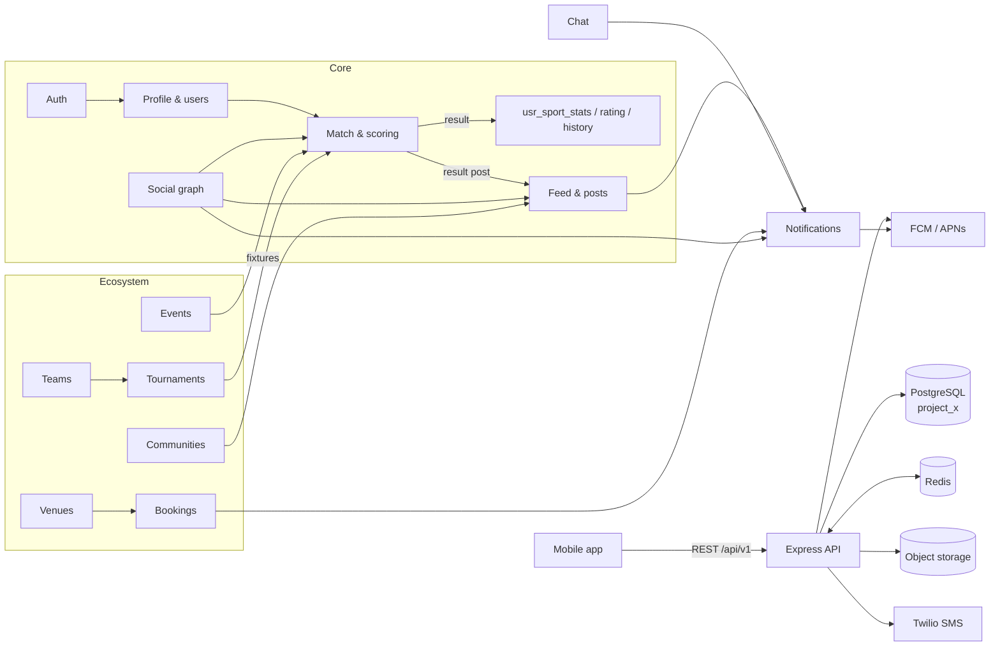

# PROJECT_X — Database Design per Module

Which data store each module uses, which tables it reads and writes, and how data flows between
modules. Covers the modules already built and the ones still on the roadmap (wiki.md "Module roadmap").

_Written 2026-10-05 from the live `project_x` schema (Neon, PostgreSQL, 46 tables in `public`) and the
backend code. Complements [mvp-data-flow.md](mvp-data-flow.md) (MVP flows) and wiki.md (APIs)._

**Status legend**

| Mark | Meaning |
| --- | --- |
| ✅ Live | Table exists in `project_x` and the backend uses it |
| 🟡 Exists | Table exists in `project_x` but no backend code uses it yet |
| 🟠 Drafted | SQL written in `docs/sql/`, waiting for the owner to apply it |
| 🔵 Proposed | Design only, in this document. Needs the owner's approval before any SQL is written |

The schema is owned by the project owner: the backend never creates or alters tables. Every 🔵 table
below is a proposal to review, not something the code assumes.

---

## 1. Data stores

| Store | Product | Holds | Used by |
| --- | --- | --- | --- |
| **PostgreSQL** | Neon, database `project_x` | All durable data (source of truth) | Every module |
| **Redis** (optional) | Upstash (Mumbai), `REDIS_URL` | Live match state + write queue, session-check cache, chat polling cache. Later: rate limits, pub/sub, counters | Auth, Match, Chat, Realtime, Notifications |
| **Object storage** 🔵 | Not chosen yet (S3 / Cloudflare R2 suggested) | Photos and videos; Postgres stores only the key and URL | Media, Profile, Posts, Communities, Venues |
| **External providers** | Twilio (SMS), Google, Apple, FCM / APNs 🔵 | OTP delivery, social sign-in, push notifications | Auth, Notifications |

There is no MongoDB or separate search engine; search runs on Postgres (`pg_trgm`, full-text).

### Module → store map

| # | Module | Postgres tables (prefix) | Redis | Object storage | Status |
| --- | --- | --- | --- | --- | --- |
| 0 | Reference data | `type_master`, `mst_*` | – | – | ✅ |
| 1 | Auth | `auth_*`, `usr_user` | `auth:*` | – | ✅ |
| 2 | Profile & users | `usr_*` | – | profile photo 🔵 | ✅ |
| 3 | Match & scoring | `match_*`, `usr_sport_*` | `live:*` | – | ✅ |
| 4 | Feed & posts | `social_post*` | – | post media 🔵 | ✅ |
| 5 | Chat | `chat_*` | `chat:*` | – | 🟠 |
| 6 | Social graph | `usr_user_follow`, `usr_user_block` | counters 🔵 | – | 🟡 |
| 7 | Media | `media_asset` | – | ✔ | 🟡 |
| 8 | Notifications | `notification`, `auth_device`, `ntf_*` | queue 🔵 | – | 🟡 / 🔵 |
| 9 | Realtime | – | pub/sub 🔵 | – | 🔵 |
| 10 | Teams | `team_*` | – | logo | 🔵 |
| 11 | Venues | `mst_city`, `venue_*` | – | photos | 🔵 |
| 12 | Bookings | `booking_*` | slot locks 🔵 | – | 🔵 |
| 13 | Events | `event_*` | – | banner | 🔵 |
| 14 | Tournaments | `tournament_*` | – | banner | 🔵 |
| 15 | Communities | `community_*` | – | cover | 🔵 |
| 16 | Search | indexes on existing tables, `search_history` | cache 🔵 | – | 🔵 |
| 17 | Moderation, admin & analytics | `user_report`, `match_report`, `admin_*` | – | – | 🟡 |

---

## 2. Conventions (all modules)

- **Ids:** `uuid DEFAULT gen_random_uuid()` for user-generated rows; `bigint` identity for reference
  and counter tables (`mst_*`, `usr_sport_stats`, `type_master`).
- **Timestamps:** `created_at`, `updated_at` on every mutable table. Auth tables use `timestamptz`;
  the rest use `timestamp` holding UTC (mvp-data-flow.md gap 7 suggests moving everything to `timestamptz`).
  New tables should use `timestamptz`.
- **Lookups:** every status / type column is a `bigint` pointing at `type_master.id`. `type_id` is
  the category and ids are fixed at `category × 100 + n` (see `backend/src/modules/match/match.codes.ts`).
  Categories 1–13 are taken; new modules continue from **14** (allocation in section 5).
- **Soft delete** where history matters (`deleted_at`), hard delete for likes, follows and memberships.
- **Names:** module prefix on the table (`usr_`, `auth_`, `match_`, `social_`, `chat_` …);
  constraints `fk_`, `uq_`, `chk_`, indexes `idx_<table>_<cols>`.
- **Blocks are global:** every module that lists users or user content excludes `usr_user_block` in
  both directions and users whose `usr_user.status` ≠ 1 (active).

---

## 3. End-to-end data flow



The match is the hub: tournaments, events and bookings all end in `match_master` rows, and every
finished match feeds stats, ratings, history and the feed in **one transaction**.

---

## 4. Modules

### Module 0 — Reference data (shared) ✅

Seeded by `npm run seed`; read by every module, written only by seeds/admin.

| Table | Purpose | Key columns |
| --- | --- | --- |
| `type_master` ✅ | Every lookup value | `id` (fixed), `type_id` (category), `description` |
| `mst_sport` ✅ | The 6 sports (ids 1–6) | `code` U, `name` U |
| `mst_sport_format` ✅ | Singles / doubles / team per sport | `sport_id`, `format_type_id`, `min_players`, `max_players` |
| `mst_sport_scoring` ✅ | Default rules per sport + format | `scoring_type_id`, `scoring_config` jsonb |
| `mst_sport_period` ✅ | Game / set / half / innings | `period_type_id`, `sequence_no`, `config` |
| `mst_sport_event` ✅ | Scorable events per sport | `event_type_id`, `event_config` |
| `mst_sport_stat` ✅ | Stats tracked per sport | `stat_code`, `data_type_id` |
| `mst_sport_rule` 🟡 | Extra per-sport rules | `rule_code`, `rule_value` |
| `mst_city` 🔵 | Cities (needed by Profile, Venues, Search) | see Module 11 |

---

### Module 1 — Auth ✅

**Stores:** Postgres + Redis (`auth:session:<sid>` 60 s, `auth:user-revoked:<uid>`) + Twilio.

```
Sign up:   /register/start ─► auth_otp (purpose 1, hashed code) ─► SMS
           /register/complete ─► verify auth_otp ─► usr_user + usr_user_profile
                                ─► auth_password_history ─► auth_session ─► tokens
Login:     identifier + password ─► usr_user ─► auth_login_log (success / failure)
                                  ─► auth_session (refresh hash) ─► tokens
Request:   Bearer JWT ─► Redis auth:session:<sid> ─(miss)─► auth_session + usr_user.status
Refresh:   rotate auth_session.refresh_token_hash (reuse of an old one ⇒ revoke)
Reset:     auth_otp (purpose 3) ─► usr_user.password_hash ─► auth_password_history
           ─► revoke all auth_session ─► Redis auth:user-revoked:<uid>
```

| Table | Status | Role |
| --- | --- | --- |
| `usr_user` | ✅ | Account: username, phone (code + number), email, `password_hash` (argon2id), `status` |
| `auth_session` | ✅ | One per signed-in device; `refresh_token_hash`, `expires_at`, `revoked_at` |
| `auth_otp` | ✅ | SMS codes (HMAC), `purpose`, `attempt_count` / `max_attempts`, 10 min expiry |
| `auth_login_log` | ✅ | Every login/logout attempt with `failure_reason` |
| `auth_password_history` | ✅ | Every password set |
| `auth_device` | 🟡 | Device + `push_token`; becomes live with Notifications (Module 8) |
| `auth_password_reset` | 🟡 | Unused (reset uses `auth_otp`) |
| `auth_account_verification` | 🟡 | Email verification once an email provider exists |
| `usr_role`, `usr_user_role` | 🟡 | Admin / moderator / venue-owner roles (Modules 11, 17) |
| `auth_identity` | 🔵 | `user_id`, `provider` (google/apple), `provider_subject` U — lets Google/Apple sign-in create and link accounts |

---

### Module 2 — Profile & users ✅

**Stores:** Postgres; profile photo in object storage (via Media).

```
PATCH /profile/me        ─► usr_user_profile (display_name, bio)
PUT /profile/me/sports   ─► usr_user_sport (is_primary)
                           ─► usr_sport_rating (1000) + usr_sport_stats (0) for new sports
GET /profile/me          ◄─ usr_user ⋈ usr_user_profile ⋈ usr_user_sport ⋈ usr_sport_stats
                            ⋈ usr_sport_rating + follower / following counts
GET /profile/me/matches  ◄─ match_participant ⋈ match_master ⋈ match_result
```

| Table | Status | Role |
| --- | --- | --- |
| `usr_user_profile` | ✅ | `display_name`, `bio`, `profile_photo` (URL), `city_id` (→ `mst_city` 🔵) |
| `usr_user_sport` | ✅ | Sports I play; one `is_primary` |
| `usr_sport_stats` | ✅ | Per user per sport: played / won / lost / points for & against |
| `usr_sport_rating` | ✅ | Elo per user per sport |
| `usr_sport_stat_history` | ✅ | One row per user per match (`stat_data` jsonb) |
| `usr_user_setting` 🔵 | 🔵 | `user_id` PK, `is_private` (follows need approval), `show_phone`, `language`, `theme` |

---

### Module 3 — Match & scoring ✅

**Stores:** Redis is the live write path; Postgres is the durable record.

```
Create  POST /matches ─► match_master (status 602 live) ─► match_team ×2
                       ─► match_participant + match_team_member ─► match_score_state (config)

Score   POST /:id/events (version)
          Redis: live:match:<id> read ─► engine ─► Lua commit (check live:version:<id>)
                 ─► push job to live:queue:<id>, add id to live:pending ─► respond
          LivePersister (background, in order, idempotent by sequence_no):
                 match_score_event ─► match_period ─► match_score_state

Undo    match_score_event.is_undone = true ─► match_correction (901) ─► replay events

Finish  flush queue, then ONE transaction:
          match_master (603) ─► match_result ─► match_stat_snapshot
          ─► usr_sport_stat_history ─► usr_sport_stats ─► usr_sport_rating (Elo)
          ─► usr_user_sport (add sport if missing) ─► social_post (801 match result)
        ─► drop Redis keys

Abandon match_master (604); nothing written to stats
```

| Table | Status | Role |
| --- | --- | --- |
| `match_master` | ✅ | Sport, format, scoring row, `created_by`, `match_type_id`, `status_id`, timestamps |
| `match_team` | ✅ | Always two sides (`team_no` 1/2, `team_name`) |
| `match_participant` | ✅ | Every player; `participant_no`, `status_id` (invite status later) |
| `match_team_member` | ✅ | Participant ↔ side |
| `match_period` | ✅ | Game / set / half / innings reached; void after undo |
| `match_score_event` | ✅ | One row per tap; `sequence_no` U per match; `is_undone` |
| `match_score_state` | ✅ | Match-level row (`state_data.config` + `snapshot`) and one per side |
| `match_correction` | ✅ | Undo audit |
| `match_result` | ✅ | Winner team / participant, `result_data` |
| `match_stat_snapshot` | ✅ | Each player's stats for this match |
| `match_stat_snapshot_detail` | 🟡 | Per-stat rows; for player-level team stats later |
| `match_report` | 🟡 | Dispute a result (Module 17) |
| `match_invite` 🔵 | 🔵 | `match_id`, `from_user_id`, `to_user_id`, `status_id` (pending/accepted/declined), `expires_at` — "challenge a player" |

**Redis keys:** `live:match:<id>`, `live:version:<id>`, `live:queue:<id>` (24 h), set `live:pending`.

**Links to other modules:** `match_master` gets nullable `tournament_fixture_id`, `event_id`,
`booking_id` columns 🔵 (or the link lives on the other side; see Modules 12–14).

---

### Module 4 — Feed & posts ✅

**Stores:** Postgres; images/videos via Media.

```
Match finish ─► social_post (801, match_id U)
POST /posts  ─► social_post (802, content, visibility 1201/1202)
             ─► social_post_media 🟡 (media from Module 7)
GET /feed    ◄─ social_post WHERE author = me OR (usr_user_follow accepted)
                MINUS usr_user_block (both ways), author active
                keyset on (created_at, id); + like / comment counts
Like         ─► social_post_like (U post_id, user_id) ─► notification 🔵
Comment      ─► social_post_comment (parent_comment_id for replies) ─► notification 🔵
```

| Table | Status | Role |
| --- | --- | --- |
| `social_post` | ✅ | `post_type_id`, `match_id` (U), `content`, `visibility_id` |
| `social_post_like` | ✅ | One like per user per post |
| `social_post_comment` | ✅ | Comments; `parent_comment_id` ready for threads |
| `social_post_media` | 🟡 | Ordered media per post (becomes live with Module 7) |
| `social_post_report` 🔵 | 🔵 | Report a post (or extend `user_report` with `reference_type_id`/`reference_id`) |

Planned columns 🔵: `social_post.community_id` (Module 15), `social_post.deleted_at`,
`social_post.like_count` / `comment_count` denormalised counters once lists get slow.

---

### Module 5 — Chat 🟠

**Stores:** Postgres (`docs/sql/2026-09-29_messaging_and_indexes.sql`) + Redis polling cache.
Realtime (Module 9) later replaces polling.

```
POST /conversations    ─► chat_conversation (1301 direct, direct_key U / 1302 group)
                       ─► chat_conversation_member (is_admin)
POST /:id/messages     ─► chat_message ─► chat_conversation.last_message_at
                       ─► member.last_read_at (sender) ─► Redis chat:last:<id>
                       ─► notification / push 🔵
GET /:id/messages?after=<newest>  ◄─ Redis chat:last:<id> (no Postgres hit when nothing new)
Unread                 = messages by others after member.last_read_at
```

| Table | Status | Role |
| --- | --- | --- |
| `chat_conversation` | 🟠 | Type, `title` (groups), `direct_key` U, `last_message_at` |
| `chat_conversation_member` | 🟠 | Membership, `is_admin`, `left_at`, `last_read_at` |
| `chat_message` | 🟠 | `content` ≤ 4000, soft delete `deleted_at` |
| `chat_message_media` 🔵 | 🔵 | Photos in chat (`message_id`, `media_asset_id`, `media_order`) |

**Redis keys:** `chat:members:<id>` (10 min), `chat:last:<id>`.

---

### Module 6 — Social graph (follow / block) 🟡

Tables exist and are read by Feed, Profile and the live list; no follow/block API yet.

```
Follow    ─► usr_user_follow (status 1 accepted, or 2 pending if usr_user_setting.is_private)
          ─► notification (new follower / follow request)
Accept    ─► usr_user_follow.status_id = 1
Block     ─► usr_user_block ─► DELETE usr_user_follow both ways ─► hides chat, feed, search
Lists     ◄─ usr_user_follow ⋈ usr_user_profile (keyset on created_at, id)
Suggest   ◄─ same usr_user_sport + mst_city + friends-of-friends (Search module)
```

| Table | Status | Role |
| --- | --- | --- |
| `usr_user_follow` | 🟡 (read ✅) | `follower_id`, `following_id` U, `status_id` |
| `usr_user_block` | 🟡 (read ✅) | `blocker_id`, `blocked_id` U |

Indexes to add 🔵: `usr_user_follow(following_id, status_id)` (followers list / counts).
Redis 🔵: `graph:counts:<uid>` cached follower/following counts.

---

### Module 7 — Media 🟡

**Stores:** object storage for bytes, Postgres for metadata. Upload goes direct from the app.

```
POST /media/uploads ─► media_asset (pending) ─► presigned PUT URL
App ── PUT file ──► object storage
POST /media/:id/complete ─► verify size/type ─► media_asset (ready, media_url, width, height)
Use ─► usr_user_profile.profile_photo | social_post_media | chat_message_media
       | venue_photo | team.logo_media_id | community.cover_media_id
```

| Table | Status | Role |
| --- | --- | --- |
| `media_asset` | 🟡 | `uploaded_by`, `media_type_id`, `storage_key`, `media_url`, `mime_type`, size, dimensions, `duration` |

Columns to add 🔵: `status_id` (pending / ready / rejected), `thumbnail_url`. Existing tables that
copy URLs (`social_post_media.media_url`, `usr_user_profile.profile_photo`) should gain a
`media_asset_id` FK so deleting or moderating an asset is possible.

---

### Module 8 — Notifications 🟡 / 🔵

**Stores:** Postgres (inbox) + Redis queue 🔵 + FCM/APNs.

```
Producer (follow, like, comment, chat, match invite, result, booking, tournament)
  ─► notification (user_id, type, title, message, reference_type_id + reference_id)
  ─► ntf_preference check ─► Redis queue ─► worker ─► auth_device.push_token ─► FCM / APNs
GET /notifications       ◄─ notification WHERE user_id ORDER BY created_at DESC
POST /notifications/read ─► is_read, read_at
```

| Table | Status | Role |
| --- | --- | --- |
| `notification` | 🟡 | In-app inbox; `reference_type_id` + `reference_id` point at the post / match / etc. |
| `auth_device` | 🟡 | `push_token`, `is_active` per device |
| `ntf_preference` | 🔵 | `user_id`, `notification_type_id`, `push_enabled`, `in_app_enabled` (U user, type) |

---

### Module 9 — Realtime 🔵

No tables. Redis pub/sub fans out changes to WebSocket connections; Postgres stays the source of truth.

```
Score commit ─► PUBLISH match:<id>        ─► spectators of /match/[id]
chat_message ─► PUBLISH chat:<conversationId> ─► members online
notification ─► PUBLISH user:<uid>        ─► badge counts
Presence     ─► Redis presence:<uid> (TTL 60 s, refreshed by heartbeat)
```

Replaces the 4 s match poll and the 3 s / 10 s chat polls.

---

### Module 10 — Teams 🔵

Persistent teams (a club, a regular 5-a-side squad). Match sides today are per-match
(`match_team`); a persistent team is linked to them.

```
Create team ─► team (captain = creator) ─► team_member (role captain)
Invite      ─► team_invite ─► notification ─► accept ─► team_member
Play        ─► match_team.team_id 🔵 → team.id  (side plays as this team)
Stats       ─► team_stats updated in the match-finish transaction
```

| Table | Key columns |
| --- | --- |
| `team` | `id` uuid, `sport_id`, `name`, `short_name`, `logo_media_id`, `city_id`, `created_by`, `visibility_id`, `deleted_at` |
| `team_member` | `team_id`, `user_id` (U pair), `role_id` (captain / vice / player), `jersey_no`, `joined_at`, `left_at` |
| `team_invite` | `team_id`, `invited_user_id`, `invited_by`, `status_id`, `expires_at` |
| `team_stats` | `team_id` U, `matches_played`, `won`, `lost`, `drawn`, `rating` |

Schema change: `match_team.team_id uuid NULL → team.id`.

---

### Module 11 — Venues 🔵

```
Owner (role venue_owner) ─► venue ─► venue_court ─► venue_slot_rule (weekly hours + price)
                         ─► venue_photo (media)
Search ◄─ venue by mst_city, sport (venue_court.sport_id), distance (lat/lng)
Review ─► venue_review (after a completed booking)
```

| Table | Key columns |
| --- | --- |
| `mst_city` | `id` bigint, `name`, `state`, `country_code`, `latitude`, `longitude`, `is_active` (also fixes `usr_user_profile.city_id`) |
| `venue` | `id`, `owner_id` → usr_user, `name`, `address`, `city_id`, `latitude`, `longitude`, `phone`, `status_id` (pending / approved / suspended), `amenities` jsonb |
| `venue_court` | `venue_id`, `sport_id`, `name` ("Court 2"), `surface`, `is_indoor`, `is_active` |
| `venue_slot_rule` | `court_id`, `day_of_week`, `open_time`, `close_time`, `slot_minutes`, `price` numeric, `currency` |
| `venue_closure` | `court_id` (or venue), `starts_at`, `ends_at`, `reason` |
| `venue_photo` | `venue_id`, `media_asset_id`, `media_order` |
| `venue_review` | `venue_id`, `user_id`, `booking_id` U, `rating` 1–5, `comment` |

---

### Module 12 — Bookings 🔵

Available slots are computed from `venue_slot_rule` − `venue_closure` − existing bookings, not stored.

```
Pick slot ─► Redis lock booking:lock:<courtId>:<start> (5 min) ─► booking (pending_payment)
Pay       ─► payment provider ─► booking_payment (webhook) ─► booking (confirmed)
          ─► notification (user + venue owner)
Cancel    ─► booking (cancelled) ─► booking_payment refund row
Play      ─► optional match_master.booking_id 🔵
```

| Table | Key columns |
| --- | --- |
| `booking` | `id`, `court_id`, `user_id`, `starts_at`, `ends_at` (timestamptz), `status_id`, `price`, `currency`, `cancelled_at`, `cancel_reason` |
| `booking_participant` | `booking_id`, `user_id` — split / shared bookings |
| `booking_payment` | `booking_id`, `provider`, `provider_ref` U, `amount`, `status_id` (pending / paid / failed / refunded), `paid_at` |

Double-booking guard: `EXCLUDE USING gist (court_id WITH =, tstzrange(starts_at, ends_at) WITH &&)
WHERE status in (pending, confirmed)` (needs `btree_gist`).

---

### Module 13 — Events 🔵

Meetups, open play sessions, coaching camps.

```
Create ─► event (host, sport, venue / booking, capacity, fee)
Join   ─► event_participant (going / waitlist) ─► notification to host
Play   ─► matches created during the event carry match_master.event_id 🔵
```

| Table | Key columns |
| --- | --- |
| `event` | `id`, `host_id`, `community_id` (nullable), `sport_id`, `title`, `description`, `venue_id`, `booking_id`, `starts_at`, `ends_at`, `capacity`, `fee`, `skill_min`/`skill_max` (rating), `visibility_id`, `status_id`, `cover_media_id` |
| `event_participant` | `event_id`, `user_id` U, `status_id` (going / waitlist / cancelled / attended), `joined_at` |

---

### Module 14 — Tournaments 🔵

> **Superseded by [scoring-and-tournaments.md](scoring-and-tournaments.md)**, which has the full
> design: corporate organizations, multi-sport categories, guest players, per-sport rules,
> standings, leaderboards and real-time scoring. The summary below is kept for reference.

Every fixture becomes an ordinary `match_master` row, so scoring, stats, ratings and the feed
work unchanged.

```
Create      ─► tournament (format: knockout / league / groups+knockout, rules)
Register    ─► tournament_entry (team or player) ─► approve
Draw        ─► tournament_stage ─► tournament_group ─► tournament_fixture (round, slot)
Fixture day ─► match_master + participants (fixture.match_id set)
Finish      ─► match finish transaction also updates tournament_standing
               and advances the winner (next fixture's entry_a/entry_b)
```

| Table | Key columns |
| --- | --- |
| `tournament` | `id`, `organizer_id`, `community_id`, `sport_id`, `format_id`, `name`, `type_id` (knockout / league / hybrid), `starts_on`, `ends_on`, `venue_id`, `entry_fee`, `max_entries`, `rules` jsonb, `status_id`, `banner_media_id` |
| `tournament_entry` | `tournament_id`, `team_id` or `user_id` (one set), `seed`, `status_id` |
| `tournament_stage` | `tournament_id`, `stage_no`, `type_id` (group / knockout), `name` |
| `tournament_group` | `stage_id`, `name` ("Group A") |
| `tournament_fixture` | `stage_id`, `group_id`, `round_no`, `fixture_no`, `entry_a_id`, `entry_b_id`, `scheduled_at`, `court_id`, `match_id` U → match_master, `winner_entry_id`, `next_fixture_id` |
| `tournament_standing` | `group_id`, `entry_id` U, `played`, `won`, `drawn`, `lost`, `points_for`, `points_against`, `points`, `rank` |

---

### Module 15 — Communities 🔵

Clubs and groups around a sport or city; posts reuse `social_post`.

```
Create ─► community ─► community_member (owner)
Join   ─► community_member (pending if private) ─► approve
Post   ─► social_post.community_id 🔵 (visible to members if private)
Events / tournaments ─► event.community_id, tournament.community_id
Group chat ─► optional chat_conversation for the community
```

| Table | Key columns |
| --- | --- |
| `community` | `id`, `name`, `slug` U, `description`, `sport_id`, `city_id`, `is_private`, `created_by`, `cover_media_id`, `member_count` |
| `community_member` | `community_id`, `user_id` U, `role_id` (owner / admin / member), `status_id` (pending / active / banned), `joined_at` |

---

### Module 16 — Search 🔵

No separate search engine. Postgres indexes on the tables that already hold the data.

```
GET /search?q=&type=players|teams|venues|communities|tournaments
  ─► pg_trgm similarity on names + filters (sport, city, rating)
  ─► exclude blocked / inactive ─► Redis cache 60 s for popular queries
```

| Object | Index |
| --- | --- |
| Players | `gin (lower(username) gin_trgm_ops)`, `gin (display_name gin_trgm_ops)` |
| Teams, venues, communities, tournaments | `gin (name gin_trgm_ops)` + `(city_id, sport_id)` |
| `search_history` 🔵 | `user_id`, `query`, `type`, `created_at` — recent searches |

---

### Module 17 — Moderation, admin & analytics 🟡

```
Report user / match / post ─► user_report | match_report (status pending)
Admin resolves ─► status, resolved_by, resolved_at ─► admin_audit_log (old/new value)
              ─► usr_user.status = 2 (suspended) ─► session revoked within 60 s
Nightly job   ─► aggregate usr_user, match_master, social_post, booking
              ─► admin_analytics_daily (date, sport, metric_type_id, metric_value)
```

| Table | Status | Role |
| --- | --- | --- |
| `user_report` | 🟡 | Reports against a user |
| `match_report` | 🟡 | Disputed / fake results |
| `admin_audit_log` | 🟡 | Every admin action with before/after JSON |
| `admin_analytics_daily` | 🟡 | One row per date × sport × metric (U) |
| `usr_role`, `usr_user_role` | 🟡 | `admin`, `moderator`, `venue_owner`, `organizer` |

---

## 5. `type_master` allocation for new modules 🔵

Categories 1–13 are in use (`match.codes.ts`). Proposed next categories:

| Category | Values |
| --- | --- |
| 14 notification type | 1401 follow, 1402 follow request, 1403 like, 1404 comment, 1405 message, 1406 match invite, 1407 match result, 1408 booking, 1409 event, 1410 tournament |
| 15 reference type | 1501 user, 1502 post, 1503 comment, 1504 match, 1505 conversation, 1506 team, 1507 venue, 1508 booking, 1509 event, 1510 tournament, 1511 community |
| 16 media type | 1601 image, 1602 video |
| 17 invite / membership status | 1701 pending, 1702 accepted, 1703 declined, 1704 expired, 1705 removed |
| 18 member role | 1801 owner, 1802 admin, 1803 captain, 1804 member |
| 19 booking status | 1901 pending payment, 1902 confirmed, 1903 cancelled, 1904 completed, 1905 no-show |
| 20 payment status | 2001 pending, 2002 paid, 2003 failed, 2004 refunded |
| 21 event / tournament status | 2101 draft, 2102 open, 2103 full, 2104 in progress, 2105 completed, 2106 cancelled |
| 22 tournament type | 2201 knockout, 2202 league, 2203 groups + knockout |
| 23 report / moderation status | 2301 pending, 2302 reviewing, 2303 actioned, 2304 dismissed |
| 24 analytics metric | 2401 new users, 2402 active users, 2403 matches played, 2404 posts, 2405 bookings |

The auth and follow codes that live only in code today (`auth.types.ts`, `profile.types.ts`) could
move into `type_master` at the same time.

---

## 6. Suggested build order (data dependencies)

1. Apply `docs/sql/2026-09-29_messaging_and_indexes.sql` → Chat goes live.
2. Social graph API + `notification` + `auth_device` → Notifications.
3. Object storage + `media_asset` → photos for profile, posts, chat.
4. `mst_city` → profile city, then Venues → Bookings.
5. Teams → Tournaments (fixtures reuse the match engine); Events; Communities.
6. Realtime (Redis pub/sub + WebSockets) once chat and live matches have users.
7. Search indexes and the analytics job as data volume grows.
