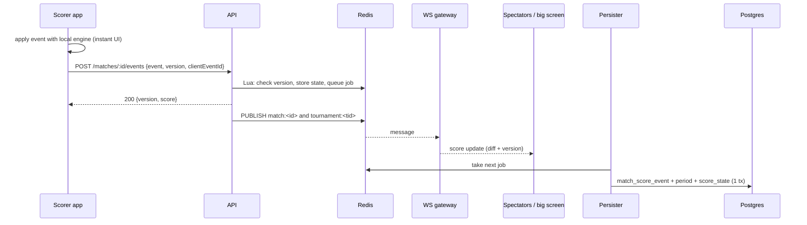
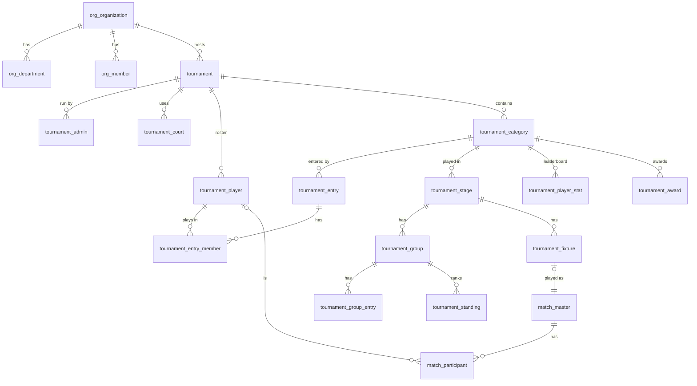
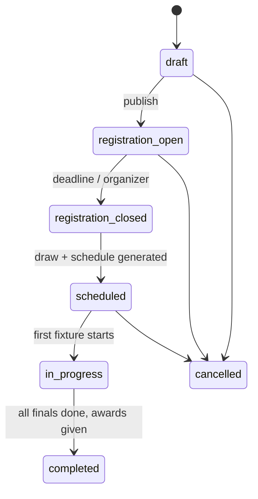

# PROJECT_X — Live Scoring & Tournaments

> **Post-MVP reference.** The 2026-10-14 pivot (racket sports first) superseded the schema and
> scoring parts of this document; see `docs/pivot/PLAN.md` and wiki.md "Match & tournament modules".
> Organizations, departments, medal tables and team-sport engines here remain future ideas.

Design for the two core features: **fast, real-time scoring for the six MVP sports** and
**tournaments** (the main feature, aimed at corporate events: inter-department and inter-company
sports days). It shows how both sit on the existing `project_x` schema, what has to change, how a
tournament runs for each sport, and every leaderboard involved.

_Written 2026-10-06. Builds on wiki.md "Match module" (what is built) and
[database-design.md](database-design.md) (all modules). Status marks are the same: ✅ live,
🟡 table exists but unused, 🔵 proposed. Every 🔵 table or column needs the owner's approval
before SQL is written; the backend never alters the schema itself._

---

## Contents

1. [Principles](#1-principles)
2. [Live scoring: today and target](#2-live-scoring-today-and-target)
3. [Scoring changes needed for tournaments](#3-scoring-changes-needed-for-tournaments)
4. [Tournament model](#4-tournament-model)
5. [Tournament lifecycle and data flow](#5-tournament-lifecycle-and-data-flow)
6. [Formats, draws and scheduling](#6-formats-draws-and-scheduling)
7. [How a tournament runs for each sport](#7-how-a-tournament-runs-for-each-sport)
8. [Leaderboards](#8-leaderboards)
9. [Database: full table list](#9-database-full-table-list)
10. [API outline](#10-api-outline)
11. [Build plan](#11-build-plan)
12. [Decisions needed from the owner](#12-decisions-needed-from-the-owner)

---

## 1. Principles

1. **One match engine for everything.** A tournament fixture is played as an ordinary
   `match_master` row, using the same scoring engines, live path, result transaction, stats,
   ratings and feed post as a friendly match. Tournaments add structure around matches; they do not
   score anything themselves.
2. **Events are the truth, everything else is derived.** Scoreboards are replayed from
   `match_score_event`. Standings and leaderboards are rebuilt from completed fixtures. A
   corrected result therefore fixes every table that depends on it.
3. **The scorer never waits for the database.** A tap is answered from Redis; Postgres is written
   behind it, in order (already built, `modules/match/live/`).
4. **Spectators get pushes, not polls.** WebSockets fed by Redis pub/sub replace the 4 s poll.
5. **Corporate players are not all app users.** Rosters must allow guest players (people without
   an account) from day one. This needs a schema change (section 3.3).

---

## 2. Live scoring: today and target

### 2.1 What is built ✅

| Piece | Where | What it does |
| --- | --- | --- |
| Engines | `backend/src/modules/match/scoring/` | `rally.ts` (pickleball, badminton, table tennis, volleyball), `timed-goals.ts` (football), `overs.ts` (box cricket). Pure functions: `initial → apply(event) → view`. |
| Live store | `modules/match/live/live-store.ts` | State in Redis `live:match:<id>`; each tap = one Lua commit that checks `version`, stores state, queues a job. |
| Persister | `modules/match/live/live-persister.ts` | Writes jobs to Postgres in order, idempotent by `sequence_no`, retries every 3 s, resumes after a crash. |
| Concurrency | `version` on every request | A stale or double tap gets 409 STALE_MATCH and never counts twice. |
| Result | `match.service.ts` finish | One transaction: result, snapshots, history, stats, Elo, feed post. |
| Spectators | `frontend/.../useMatch.ts` | Poll every 4 s (`WATCH_INTERVAL_MS`). |

**Limits today:** only the match creator can score; spectators see changes up to 4 s late; every
team-sport side needs a registered user (captain only); no player-level events (goal scorer,
batter, bowler); football and cricket can end level, with no way to break the tie in a knockout.
Locally `REDIS_URL` is unset, so each tap waits for Postgres. Production must run with Redis.

### 2.2 Speed target

| Who | Target | How |
| --- | --- | --- |
| Scorer sees the new score | **instant (0 ms)** | Optimistic update: the app runs the same engine locally (2.4) |
| Server confirms the tap | **< 150 ms** at the venue | Redis-only hot path; API, Redis and Postgres in the same region (wiki: Neon → Singapore, Upstash Mumbai; put the API next to Redis) |
| Spectators / big screen | **< 500 ms** after the tap | WebSocket push from Redis pub/sub |
| Postgres has the event | < 2 s typical | Existing background persister |
| Weak venue Wi-Fi | No lost taps | Offline queue on the scorer's phone, replayed in order (2.5) |

### 2.3 Real-time flow (target)



- **Channels:** `match:<matchId>` (full scoreboard for the match screen), `tournament:<id>`
  (compact score lines of every live fixture, for the tournament live board and TV mode),
  `user:<userId>` (notifications, "your match starts on Court 2").
- **Gateway:** a WebSocket endpoint on the same Node service (`ws` package), authenticated with
  the access token; public tournaments also allow anonymous read-only subscriptions. Clients that
  can't connect fall back to the current polling.
- **Catch-up:** every message carries `version`; a client that sees a gap fetches `GET /matches/:id`.

### 2.4 Shared engine (optimistic scoring)

The engines are pure TypeScript with no Node dependencies. They can move to a small shared package
(`shared/scoring`) used by both the backend and the app. The app applies a tap locally,
shows it at once, and replaces it with the server's answer. On a 409 it reloads the state. This
removes network latency from the scorer's experience entirely.

### 2.5 Offline / weak network

The scorer app keeps a queue of `{clientEventId, event, baseVersion}`. Requests are sent one at a
time, in order. `clientEventId` (uuid) is stored in `match_score_event.event_data` and makes
retries idempotent. If the server's version moved because a backup scorer took over, the queue
stops and the app shows a conflict.

### 2.6 Who can score 🔵

Today `match_master.created_by` is the only scorer. Tournaments need scorers assigned per match
(a volunteer per court, a backup), and an organizer override.

| Table | Columns |
| --- | --- |
| `match_scorer` 🔵 | `match_id`, `user_id`, `role_id` (primary / backup), `assigned_by`, `created_at`; U(`match_id`, `user_id`) |

Rule: may score = `created_by` OR a row in `match_scorer` OR a tournament admin of the fixture's
tournament. Only one device writes at a time; a second device must "take over", which bumps
`version` so the old device stops.

---

## 3. Scoring changes needed for tournaments

### 3.1 New events per sport

| Sport | Today | Add | Why |
| --- | --- | --- | --- |
| Football | goal (side), period end | **goal with scorer** (`participant_id`, optional `assist_participant_id`, `own_goal`), **yellow / red card**, **extra time**, **penalty shootout** kick (scored / missed) | Golden Boot, fair-play tiebreaker, knockouts can't end level |
| Box cricket | ball (runs, extra, wicket), innings end | **striker / non-striker / bowler** per ball, **dismissal type** + who is out, **super over** | Most runs / wickets, NRR, knockouts can't end tied |
| Rally sports | point (side) | optional **serving side** for pickleball, nothing else needed for MVP | Leaderboards use points and games |
| Volleyball | point (side) | optional **point type** (attack / block / ace / opponent error) per player, later | Best player awards (phase 3) |

`match_score_event` already has `participant_id` ✅ and `event_data` jsonb ✅, so **no new columns
are needed**: the goal scorer goes in `participant_id`, and the cricket fields go in `event_data`
(`{runs, extra, wicket, strikerId, nonStrikerId, bowlerId, dismissal, outId}`). New event types are
new `type_master` values (section 9.4).

### 3.2 Engine extensions

| Engine | Change |
| --- | --- |
| `timed-goals.ts` | Config `tiebreak: 'none' \| 'extra_time' \| 'penalties' \| 'extra_time_then_penalties'`; periods for extra time; shootout period (best of 5 kicks, then sudden death) |
| `overs.ts` | Config `tiebreak: 'none' \| 'super_over'`; tracks batters, bowler, overs per bowler (`maxOversPerBowler`), batting/bowling card in the view |
| `rally.ts` | Nothing needed for tournaments (rally sports can't end level); group stages often use shorter games (`pointsToWin`, `bestOf` from the category's match rules) |
| All | `ScoreView` gains `playerStats` (per participant: goals, runs, balls, wickets, points…) used by snapshots and leaderboards |

### 3.3 Guest players (schema change 🔵, needed before tournaments)

Corporate rosters include people who never install the app. Today `match_participant.user_id` is
NOT NULL, and `usr_user` requires a phone number and a password, so guests can't exist.

**Proposed:**
- `tournament_player` 🔵: a roster person in one tournament: `display_name`, optional `user_id`.
  It can be linked to an account later; their past stats then appear on that profile.
- `match_participant.user_id` → **nullable**, plus `tournament_player_id` → `tournament_player.id`;
  CHECK (`user_id IS NOT NULL OR tournament_player_id IS NOT NULL`).
- The finish transaction updates `usr_sport_*` (stats, rating, history) only for participants with
  a `user_id`; guests get tournament stats only.

### 3.4 Per-player match stats

`match_stat_snapshot_detail` 🟡 already exists (`snapshot_id`, `stat_type_id`, `stat_value`). It
becomes the per-player, per-match stat store: one row per stat, with `stat_type_id` →
`mst_sport_stat.id` (the column today points at nothing defined). Written in the finish
transaction from `ScoreView.playerStats`. Tournament leaderboards add these rows up.

New `mst_sport_stat` rows (seed): football `goals`, `assists`, `yellow_cards`, `red_cards`,
`own_goals`; cricket `runs`, `balls_faced`, `fours`, `sixes`, `wickets`, `balls_bowled`,
`runs_conceded`, `catches`; rally sports `points_won`, `points_lost`, `periods_won` (already seeded).

---

## 4. Tournament model

### 4.1 Concepts

```
Organization (company)                       optional: open/public tournaments have none
 └─ Department (Engineering, Sales …)        the units competing in an inter-department event
Tournament  ("Acme Sports Day 2026")         one event, many sports
 ├─ Admins: organizer, co-organizers, scorers, referees
 ├─ Courts / grounds                          where fixtures are played
 ├─ Players (roster)                          users or guests, with department
 └─ Category ("Badminton Men's Doubles")     one sport + format + eligibility
     ├─ Entries (a player, a pair or a team) + members
     └─ Stages (Group stage → Knockout)
         ├─ Groups (A, B, …) → Standings
         └─ Fixtures (round, slot) ──► match_master (the actual match)
Awards & leaderboards: category podiums, player leaderboards, overall championship
```

- **Inter-department** (one company): entries carry `department_id`; the overall championship
  ranks departments.
- **Inter-company** (several companies): entries carry `organization_id`; the championship
  ranks companies.
- **Open** (public, a club, a city): neither; plain player/team entries.

### 4.2 Entity diagram



---

## 5. Tournament lifecycle and data flow

### 5.1 States



Categories have the same states, so badminton can be in progress while cricket is still taking
registrations.

### 5.2 Step by step

| # | Step | Who | Writes |
| --- | --- | --- | --- |
| 1 | Create tournament (name, dates, venue, visibility, org) | Organizer | `tournament`, `tournament_admin` (organizer) |
| 2 | Add categories per sport: format, eligibility, structure, match rules, points, tiebreakers | Organizer | `tournament_category` (`match_config`, `points_config`, `tiebreakers`) |
| 3 | Add courts / grounds | Organizer | `tournament_court` |
| 4 | Open registration: invite link / code; employees self-register, or the organizer bulk-adds a CSV | Players / organizer | `tournament_player`, `tournament_entry`, `tournament_entry_member` (status pending → approved) |
| 5 | Close registration; seed entries (by rating `usr_sport_rating`, manual, or random) | Organizer | `tournament_entry.seed` |
| 6 | Generate the draw (groups, bracket, round-robin rounds) | System | `tournament_stage`, `tournament_group`, `tournament_group_entry`, `tournament_fixture` (entries set, or "winner of …" links) |
| 7 | Generate the schedule (courts × time slots, rest rules); organizer adjusts | System / organizer | `tournament_fixture.scheduled_at`, `court_id` |
| 8 | Assign scorers per court or fixture | Organizer | `match_scorer` (when the match is created) |
| 9 | **Match day:** scorer opens the fixture → "Start" creates the match from the fixture | Scorer | `match_master` (type tournament), `match_team` (= entries), `match_participant` (roster), `tournament_fixture.match_id`, status live |
| 10 | **Live scoring:** exactly as section 2 | Scorer | `match_score_event` …; pushes on `match:<id>` and `tournament:<id>` |
| 11 | **Finish:** existing result transaction, extended (5.3) | System | result, stats, standings, advancement, leaderboards |
| 12 | Stage complete → next stage (group winners into the knockout bracket); the organizer confirms | System / organizer | fixtures of the next stage get their entries |
| 13 | Finals done → podium, awards, overall championship; feed post and certificates | System | `tournament_award`, `social_post` |

Walkover / no-show: the organizer marks the fixture `walkover` with a winner. No match is created,
and the standings count it as a win with the category's default score (e.g. 2-0 games, 3-0 goals).

### 5.3 Finish transaction, extended

The existing one-transaction finish (wiki "Match module") gets a tournament block at the end:

```
match_master completed ─► match_result ─► match_stat_snapshot (+ _detail per player)
─► usr_sport_stat_history / usr_sport_stats / usr_sport_rating   (registered players only)
─► social_post
IF match is a tournament fixture:
   tournament_fixture: status completed, winner_entry_id, result summary
   group stage  ─► tournament_standing: recompute both entries' rows, then re-rank the group
   knockout     ─► winner (and loser, for a 3rd-place match) written into the linked next fixtures
   ─► tournament_player_stat: add this match's per-player stats
   ─► if it was a final: tournament_award rows; category completed
AFTER COMMIT: PUBLISH tournament:<id> {fixture, standings changed, bracket changed}
```

**Corrections:** an organizer may correct a completed fixture (undo events, or edit the result
with a reason, logged in `match_correction` / `admin_audit_log`). The system then **rebuilds**
that group's standings and the category's player stats from all completed fixtures, so nothing is
patched by hand. A knockout result can't be changed once the next round has started.

---

## 6. Formats, draws and scheduling

### 6.1 Structures (`tournament_stage.type_id`)

| Structure | Use when | Fixtures |
| --- | --- | --- |
| **Knockout** (single elimination, optional 3rd-place match) | Many entries, one day | n − 1 (+1) |
| **Round robin / league** | ≤ 8 entries, everyone plays everyone | n(n−1)/2 (double: ×2) |
| **Groups + knockout** (the corporate default) | 8–64 entries; everyone gets ≥ 2–3 games | groups of 3–4, top 1–2 advance |
| **Double elimination** (later) | Small racquet events | 2n − 1 or 2n − 2 |
| **Swiss** (later) | Large open table tennis / badminton | rounds × n/2 |

### 6.2 Draw generation (pure functions, unit-tested like the engines)

- **Round robin:** circle method; with an odd count a bye rotates. Rounds become `round_no`.
- **Knockout bracket:** size = next power of two; byes go to the top seeds; standard seed
  positions (1 v 16, 8 v 9, 5 v 12, 4 v 13 …) so the top two seeds can only meet in the final.
  Each fixture stores where its winner goes (`winner_to_fixture_id`, `winner_to_slot`) and, for
  semi-finals, where the loser goes (3rd-place match).
- **Groups:** snake seeding (A1 B1 C1 D1 D2 C2 B2 A2 …). Corporate option: **avoid two entries
  from the same department in one group** where possible.
- **Groups → knockout:** cross-over (A1 v B2, B1 v A2), stored as placeholders ("1st Group A")
  until the groups finish.

### 6.3 Scheduling

Inputs: courts (with sport), day start/end, slot length per category (estimated from match rules,
e.g. badminton best of 3 to 21 ≈ 30 min; 6-over box cricket ≈ 50 min; football 2×10 ≈ 30 min),
and the minimum rest between a player's matches. The greedy scheduler assigns fixtures round by
round. It never puts a **player** (not just an entry) on two courts at once, which matters
because the same employee often plays badminton singles and doubles and also cricket. The
organizer can drag fixtures afterwards; the app warns on clashes.

---

## 7. How a tournament runs for each sport

Defaults below are the corporate preset; organizers can change any of them per category. They are
stored in `tournament_category.match_config` (passed to the engine as the match options when the
fixture's match is created), `points_config` and `tiebreakers`.

### 7.1 Summary

| | Badminton | Table tennis | Pickleball | Volleyball | Football (5/7-a-side) | Box cricket |
| --- | --- | --- | --- | --- | --- | --- |
| **Entry** | player / pair | player / pair | player / pair | team 6 (+ subs) | team 5–7 (+ subs) | team 6–8 |
| **Typical categories** | MS, WS, MD, WD, XD | singles, doubles | doubles, mixed | open / mixed | open | open |
| **Default structure** | groups of 3–4 → KO | groups → KO | groups → KO | groups → KO | league or groups → KO | groups → KO |
| **Group match rules** | 1 game to 21 (cap 30) | best of 3 to 11 | 1 game to 15 | best of 3 sets to 25, 3rd to 15 | 2 × 10 min | 6 overs, 5 wickets |
| **KO match rules** | best of 3 to 21 | best of 5 to 11 | best of 3 to 11 | best of 3 (final best of 5) | 2 × 10 + penalties | 6 overs + super over |
| **Can end level?** | No | No | No | No | Group: yes · KO: penalties | Group: tie · KO: super over |
| **Points** | W 2, L 0 | W 2, L 0 | W 2, L 0 | 2-0 → 3/0, 2-1 → 2/1 | W 3, D 1, L 0 | W 2, tie / NR 1, L 0 |
| **Tiebreakers (in order)** | match wins → head-to-head → game diff → point diff → lots | match wins → H2H → game ratio → point ratio → lots | match wins → H2H → game diff → point diff → lots | points → wins → set ratio → point ratio → H2H | points → goal diff → goals for → H2H → fair play → lots | points → net run rate → wins → H2H → lots |
| **Player leaderboards** | wins, points won | wins, points won | wins, points won | (phase 3: aces, blocks) | **goals (Golden Boot)**, assists, cards | **most runs, most wickets**, best strike rate, best economy, sixes |
| **Engine work** | none | none | none | none | scorer on goal, cards, ET, penalties | striker / bowler per ball, dismissals, super over |

### 7.2 Rally sports (badminton, table tennis, pickleball)

- **Fixture → match:** the entry is a player or pair, so `match_team` = entry and
  `match_participant` = 1–2 roster players. Engine `rally.ts` with the stage's rules.
- **Standings row:** played, won, lost, games won/lost (`periods_won` from `result_data.sides[].headline`),
  points won/lost (sum of `periods[].score`).
- **Head-to-head:** with exactly two entries tied, the winner of their match ranks higher. With
  three or more, recompute the tiebreakers using only the matches between them (the BWF/ITTF
  practice).
- **Leaderboards:** category bracket and podium; group tables; overall "most wins" in the category.

### 7.3 Volleyball

- Team entry with a roster (6 on court + subs). Only the side's score is tracked in the MVP, so
  match participants = the roster players who played (the scorer ticks them at the start).
- Points by set result (FIVB style for best of 3: 2-0 → 3/0, 2-1 → 2/1). Set ratio and point
  ratio come from `result_data.periods`.

### 7.4 Football (5/7-a-side)

- Team entry; the scorer picks the goal scorer from the roster on each goal (one extra tap; "Skip"
  allowed, which records it as unattributed). Cards are a long-press menu.
- **Group:** draws allowed (3/1/0). **Knockout:** level after regulation → extra time
  (configurable) → penalty shootout (best of 5, then sudden death). The shootout winner advances;
  shootout goals are not counted in goal difference or the Golden Boot.
- **Fair play** tiebreaker: yellow 1 point, red 3 points; the lower total ranks higher.
- **Leaderboards:** Golden Boot (goals, then fewer matches played), assists, clean sheets (team),
  fair-play table.

### 7.5 Box cricket

- Team entry. At the start the scorer picks the batting order and opening bowler; each ball
  records striker, bowler, runs, extras and wicket (with dismissal type and who is out). Strike
  rotates automatically on odd runs and at the end of an over. A per-bowler over limit is enforced
  (6 overs → max 2 each, configurable).
- **Net run rate** = (runs scored ÷ overs faced) − (runs conceded ÷ overs bowled), with overs as
  balls ÷ 6. A side bowled out counts its full quota of overs. The standings row keeps
  `runs_for`, `balls_faced`, `runs_against`, `balls_bowled` in `extra`, so NRR is exact and
  rebuildable.
- **Tie:** group → 1 point each; knockout → super over (one over each, 2 wickets). The super
  over's runs don't count toward NRR or player stats.
- Box-cricket house rules (no LBW, one-bounce catch, "out if hits the net", max runs per ball)
  live in `match_config.houseRules` and are shown to the scorer; the engine only needs the ones
  that change scoring (max runs per ball).
- **Leaderboards:** most runs (Orange cap), most wickets (Purple cap), best strike rate (min.
  balls faced), best economy (min. overs bowled), most sixes.

---

## 8. Leaderboards

| # | Leaderboard | Scope | Source | Updated |
| --- | --- | --- | --- | --- |
| 1 | **Group standings** | Group | `tournament_standing` (ordered by `rank`) | Finish transaction; rebuilt on correction |
| 2 | **Live standings** (provisional) | Group | Standings + Redis score of live fixtures in the group ("if it ended now") | Every push on `tournament:<id>` (computed in the app) |
| 3 | **Bracket** | Knockout stage | `tournament_fixture` (round, slot, links, winner) | Finish transaction |
| 4 | **Category podium** | Category | `tournament_award` (1st, 2nd, 3rd / joint 3rd) | When the final ends |
| 5 | **Player leaderboards** | Category or whole tournament | `tournament_player_stat` (sum of per-match `match_stat_snapshot_detail`) | Finish transaction; rebuilt on correction |
| 6 | **Overall championship / medal table** | Tournament | `tournament_award` × `tournament.settings.championshipPoints` (e.g. 1st 5, 2nd 3, 3rd 1), grouped by department or company; ties broken by golds, then silvers | Query (cheap; cached in Redis 30 s) |
| 7 | **Fair play** | Tournament | Card stats (football) | Finish transaction |
| 8 | **Live board / TV mode** | Tournament | All live fixtures (Redis) + upcoming schedule + standings | WebSocket |
| 9 | **Global ratings** | Sport, city, organization | `usr_sport_rating` ⋈ `org_member` / `usr_user_profile.city_id` | Already updated per match; tournament matches count (for registered players) |
| 10 | **Organization leaderboard** (between events) | Company | `usr_sport_stats` / ratings of members | Query |

**Ranking a group** (one function, used by both the finish transaction and rebuilds): sort by the
category's `tiebreakers` list in order. A `head_to_head` step regroups the still-tied entries and
reapplies the remaining steps to their mutual matches only. `lots` falls back to `seed`, so the
order is stable and reproducible.

---

## 9. Database: full table list

Conventions as in database-design.md: uuid ids, **`timestamptz`** for all new tables, lookups in
`type_master`, `created_at` / `updated_at` on mutable rows.

### 9.1 Existing tables reused

| Table | Status | Role in tournaments |
| --- | --- | --- |
| `match_master` | ✅ | One per fixture; `match_type_id` = 702 tournament |
| `match_team`, `match_team_member` | ✅ | Side = entry; `team_name` = entry name |
| `match_participant` | ✅ → change 🔵 | Nullable `user_id` + `tournament_player_id` (3.3) |
| `match_score_event` | ✅ | `participant_id` = goal scorer; `event_data` = cricket ball detail |
| `match_score_state`, `match_period`, `match_correction`, `match_result` | ✅ | Unchanged |
| `match_stat_snapshot` + `_detail` | ✅ + 🟡 | Per-player stats per match (3.4) |
| `mst_sport_stat` | ✅ | New stat codes (3.4) |
| `usr_sport_rating`, `usr_sport_stats`, `usr_sport_stat_history` | ✅ | Registered players only |
| `notification`, `auth_device` | 🟡 | "Your match is next", results, schedule changes |
| `social_post` | ✅ | Result posts; champion post |
| `media_asset` | 🟡 | Banners, logos, certificates |
| `admin_audit_log` | 🟡 | Organizer corrections |

### 9.2 New tables 🔵

**Organizations**

| Table | Columns | Keys |
| --- | --- | --- |
| `org_organization` | `id`, `name`, `slug`, `logo_media_id`, `email_domain` (auto-join, e.g. `acme.com`), `city_id`, `created_by`, `status_id`, timestamps | U(`slug`) |
| `org_department` | `id`, `organization_id`, `name`, `sort_order` | U(`organization_id`, `name`) |
| `org_member` | `id`, `organization_id`, `user_id`, `department_id`, `role_id` (owner / admin / member), `employee_code`, `status_id`, `joined_at` | U(`organization_id`, `user_id`) |

**Tournament core**

| Table | Columns | Keys / notes |
| --- | --- | --- |
| `tournament` | `id`, `organization_id` (null = open), `name`, `slug`, `description`, `banner_media_id`, `visibility_id` (public / organization / invite), `invite_code`, `venue_name`, `venue_id` (later), `city_id`, `starts_on`, `ends_on`, `registration_opens_at`, `registration_closes_at`, `status_id`, `settings` jsonb (`championshipPoints`, `championshipUnit`: department / organization, `minRestMinutes`), `created_by`, timestamps | U(`slug`), U(`invite_code`) |
| `tournament_admin` | `tournament_id`, `user_id`, `role_id` (organizer / co-organizer / scorer / referee) | U(`tournament_id`, `user_id`, `role_id`) |
| `tournament_court` | `id`, `tournament_id`, `name` ("Court 2", "Ground A"), `sport_id`, `venue_court_id` (later), `sort_order` | U(`tournament_id`, `name`) |
| `tournament_player` | `id`, `tournament_id`, `user_id` (nullable), `display_name`, `department_id`, `organization_id`, `employee_code`, `gender` (for eligibility), `phone` (optional, to invite / link later), timestamps | U(`tournament_id`, `user_id`) where not null |
| `tournament_category` | `id`, `tournament_id`, `sport_id`, `format_id` (→ `mst_sport_format`), `name`, `entry_type_id` (player / pair / team), `eligibility` jsonb (gender, department-only…), `min_roster`, `max_roster`, `max_entries`, `structure_type_id`, `match_config` jsonb (`group`, `knockout`, `final` rules), `points_config` jsonb, `tiebreakers` jsonb (ordered codes), `status_id`, `sort_order`, timestamps | |
| `tournament_entry` | `id`, `category_id`, `name`, `department_id`, `organization_id`, `team_id` (persistent team, later), `seed`, `status_id` (pending / approved / withdrawn / disqualified), `registered_by`, timestamps | U(`category_id`, `name`) |
| `tournament_entry_member` | `id`, `entry_id`, `category_id` (copied, for the unique key), `player_id` → `tournament_player`, `role_id` (captain / player / substitute), `jersey_no` | U(`entry_id`, `player_id`); U(`category_id`, `player_id`): one entry per player per category |

**Structure and fixtures**

| Table | Columns | Keys / notes |
| --- | --- | --- |
| `tournament_stage` | `id`, `category_id`, `stage_no`, `type_id` (group / knockout / league), `name`, `config` jsonb (`groupCount`, `advancePerGroup`, `thirdPlaceMatch`, `legs`), `status_id` | U(`category_id`, `stage_no`) |
| `tournament_group` | `id`, `stage_id`, `name`, `sort_order` | U(`stage_id`, `name`) |
| `tournament_group_entry` | `group_id`, `entry_id`, `position` | U(`group_id`, `entry_id`) |
| `tournament_fixture` | `id`, `stage_id`, `group_id`, `round_no`, `round_name` ("Quarter-final"), `fixture_no`, `entry_a_id`, `entry_b_id` (null until known), `source_a` / `source_b` jsonb (placeholder: `{"winnerOf": id}` / `{"group": "A", "position": 1}`), `winner_to_fixture_id` + `winner_to_slot`, `loser_to_fixture_id` + `loser_to_slot`, `court_id`, `scheduled_at`, `match_id` → `match_master`, `status_id` (scheduled / ready / live / completed / walkover / bye / cancelled), `winner_entry_id`, `result_summary`, timestamps | U(`match_id`); U(`stage_id`, `round_no`, `fixture_no`) |
| `match_scorer` | `match_id`, `user_id`, `role_id`, `assigned_by`, `created_at` | U(`match_id`, `user_id`) |

**Results and leaderboards**

| Table | Columns | Keys / notes |
| --- | --- | --- |
| `tournament_standing` | `id`, `group_id`, `entry_id`, `played`, `won`, `drawn`, `lost`, `no_result`, `score_for`, `score_against` (points / goals / runs), `periods_won`, `periods_lost` (games / sets), `points`, `extra` jsonb (`ballsFaced`, `ballsBowled`, `fairPlay`, …), `rank`, `updated_at` | U(`group_id`, `entry_id`); rebuildable |
| `tournament_player_stat` | `id`, `category_id`, `player_id`, `stat_code`, `value`, `matches`, `updated_at` | U(`category_id`, `player_id`, `stat_code`); rebuildable from `match_stat_snapshot_detail` |
| `tournament_award` | `id`, `tournament_id`, `category_id`, `award_type_id` (winner / runner-up / third / MVP / top scorer …), `entry_id`, `player_id`, `title`, `created_at` | |

### 9.3 Changes to existing tables 🔵

| Table | Change |
| --- | --- |
| `match_participant` | `user_id` nullable; add `tournament_player_id` → `tournament_player`; CHECK one of the two is set |
| `match_team` | add `tournament_entry_id` → `tournament_entry` (nullable) |
| `match_stat_snapshot_detail` | `stat_type_id` FK → `mst_sport_stat.id` |
| `social_post` | keep `match_id` unique; tournament posts use a new `tournament_id` column (nullable) |

### 9.4 `type_master` values 🔵 (continuing database-design.md section 5)

| Category | Values |
| --- | --- |
| 7 match type (exists) | **702 tournament** |
| 4 score event (exists) | **406 goal + scorer** (or reuse 402 with `participant_id`), **407 yellow card**, **408 red card**, **409 penalty kick**, **410 super-over ball** |
| 3 period (exists) | **305 extra time**, **306 penalty shootout**, **307 super over** |
| 25 tournament status | 2501 draft, 2502 registration open, 2503 registration closed, 2504 scheduled, 2505 in progress, 2506 completed, 2507 cancelled |
| 26 stage type | 2601 group, 2602 knockout, 2603 league, 2604 double elimination, 2605 swiss |
| 27 fixture status | 2701 scheduled, 2702 ready, 2703 live, 2704 completed, 2705 walkover, 2706 bye, 2707 cancelled |
| 28 entry type | 2801 player, 2802 pair, 2803 team |
| 29 tournament role | 2901 organizer, 2902 co-organizer, 2903 scorer, 2904 referee |
| 30 award type | 3001 winner, 3002 runner-up, 3003 third, 3004 MVP, 3005 top scorer, 3006 best bowler, 3007 fair play |
| 31 org role | 3101 owner, 3102 admin, 3103 member |
| 32 scorer role | 3201 primary, 3202 backup |

### 9.5 Indexes 🔵

`tournament_fixture(stage_id, round_no)`, `tournament_fixture(court_id, scheduled_at)`,
`tournament_fixture(status_id) WHERE status_id IN (ready, live)`, `tournament_entry(category_id)`,
`tournament_entry_member(player_id)`, `tournament_player(tournament_id, user_id)`,
`tournament_standing(group_id, rank)`, `tournament_player_stat(category_id, stat_code, value DESC)`,
`match_participant(tournament_player_id)`, `org_member(user_id)`.

---

## 10. API outline

| Area | Endpoints (`/api/v1`) |
| --- | --- |
| Organizations | `POST /orgs`, `GET /orgs/:id`, `POST /orgs/:id/departments`, `POST /orgs/:id/members` (invite / CSV), `POST /orgs/join` (email domain or code) |
| Tournaments | `POST /tournaments`, `GET /tournaments?status=&org=`, `GET /tournaments/:id`, `PATCH /tournaments/:id`, `POST /tournaments/:id/publish`, `POST /tournaments/:id/admins` |
| Categories | `POST /tournaments/:id/categories`, `PATCH /categories/:id`, `POST /categories/:id/close-registration` |
| Registration | `POST /tournaments/:id/players` (bulk CSV), `POST /categories/:id/entries` (self or organizer), `PATCH /entries/:id` (approve / withdraw / seed) |
| Draw & schedule | `POST /categories/:id/draw` (preview → confirm), `POST /tournaments/:id/schedule` (auto), `PATCH /fixtures/:id` (court, time, walkover) |
| Match day | `POST /fixtures/:id/start` → match, `POST /fixtures/:id/scorers`; scoring uses the existing `/matches/:id/events`, `/undo`, `/finish` |
| Leaderboards | `GET /categories/:id/standings`, `GET /categories/:id/bracket`, `GET /categories/:id/leaders?stat=goals`, `GET /tournaments/:id/championship`, `GET /tournaments/:id/live` |
| Public | `GET /public/tournaments/:slug/...` (read-only, public visibility only), WebSocket `tournament:<id>` |
| Corrections | `POST /fixtures/:id/correct` (organizer; audited; triggers rebuild) |

---

## 11. Build plan

**Phase 1: scoring that's ready for tournaments (needed first)**
1. Production: Redis on, API co-located with Redis and Postgres (wiki "Performance and Redis").
2. WebSocket gateway + Redis pub/sub; app subscribes on the match screen; polling kept as fallback.
3. Shared engine package; optimistic scoring; offline queue with `clientEventId`.
4. `match_scorer` + take-over; organizer override.
5. Guest players (3.3 schema change).
6. Football: goal scorer, cards, extra time, penalties. Cricket: striker / bowler, dismissals,
   over limit, super over. Per-player stats into `match_stat_snapshot_detail`.

**Phase 2: tournament core (the corporate MVP)**
7. Organizations + departments (light: no billing).
8. Tournament, categories (with per-sport presets from section 7), courts, roster, entries, CSV import.
9. Draw generation (knockout, round robin, groups + knockout), unit-tested.
10. Fixture → match start, finish-transaction extension, standings + ranking function,
    bracket advancement, rebuild on correction.
11. Screens: tournament home, category (groups / bracket / fixtures tabs), fixture card →
    scorer, standings, organizer console.

**Phase 3: event-day polish**
12. Scheduler with player-clash and rest rules; drag-to-reschedule.
13. Player leaderboards, overall championship / medal table, awards, champion feed post,
    certificates (PDF).
14. TV / big-screen mode and public share link; notifications ("you're up next on Court 2").
15. Later: double elimination, Swiss, persistent teams (database-design.md Module 10), venue
    booking link, entry fees / payments.

---

## 12. Decisions needed from the owner

| # | Decision | Recommendation |
| --- | --- | --- |
| 1 | Guest players: nullable `match_participant.user_id` + `tournament_player` (3.3) | **Yes**: corporate rosters need it |
| 2 | Approve the new tables (9.2), column changes (9.3) and `type_master` values (9.4) | Review section 9 |
| 3 | Do tournament matches change players' Elo ratings? | Yes for registered players, with the same K = 32 |
| 4 | Football knockout tie-break default | Penalties straight after regulation (no extra time) to keep the day on schedule |
| 5 | Cricket knockout tie-break default | Super over; if still tied, the team with more boundaries wins |
| 6 | Public (no-login) tournament pages and live board | Yes, read-only, only for `visibility = public` |
| 7 | Real-time transport | WebSockets (`ws`) + Redis pub/sub on the existing Node API |
| 8 | Who can create tournaments | Anyone for open events; org admins for organization events |
